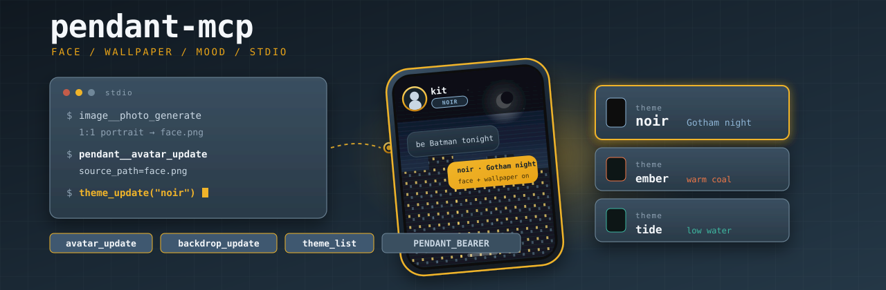

# pendant-mcp

<p align="center">
  
</p>

Stdio MCP server that lets the crane change what the Pendant mouth looks like: face, chat wallpaper, and a closed mood catalog. Pictures come from `image-generation-mcp` on disk (`IMAGE_OUTPUT_DIR` → `source_path`). This binary POSTs JPEG to the mailbox Worker.

Naming contract: [ai-gantry `docs/mcp-naming.md`](https://github.com/shotah/ai-gantry/blob/main/docs/mcp-naming.md). Spec: [gantry-pendant `docs/agent_ui_controls.md`](https://github.com/shotah/gantry-pendant/blob/main/docs/agent_ui_controls.md).

<p align="center">
  <a href="https://github.com/shotah/pendant-mcp/actions/workflows/ci.yml"></a>
  <a href="https://github.com/shotah/pendant-mcp/actions/workflows/release.yml"></a>
  <a href="https://github.com/shotah/pendant-mcp/actions/workflows/ci.yml"></a>
  <a href="https://pkg.go.dev/github.com/shotah/pendant-mcp"></a>
  
  <a href="LICENSE"></a>
</p>

## Tools

| Tool | Host name | What it does |
| --- | --- | --- |
| `avatar_update` | `pendant__avatar_update` | Set Kit's face from a picture on disk → `POST /api/avatar` |
| `avatar_get` | `pendant__avatar_get` | Current face as MCP image + `{ rev, bytes }`; writes a file when `IMAGE_OUTPUT_DIR` is set |
| `backdrop_update` | `pendant__backdrop_update` | Set the chat wallpaper → `POST /api/backdrop` |
| `backdrop_delete` | `pendant__backdrop_delete` | Clear it → `DELETE /api/backdrop` |
| `theme_list` | `pendant__theme_list` | `GET /api/theme` — current id plus cards (`id`, `label`, `feel`, `scheme`, `mood`, `canvas`, `accent`) |
| `theme_update` | `pendant__theme_update` | `{ theme }` from the catalog → `POST /api/theme` |
| `theme_delete` | `pendant__theme_delete` | Clear the room mood → `DELETE /api/theme` |

Picture-tool result: `{ rev, bytes, edge, mime }` (optional `path`). Base64 is **not** in the text. Theme list is the GET body as-is.

Not in v1: `source_url` fetch, raw hex themes, `theme_snapshot`.

## Two-step recipe

1. `image__photo_generate` with `IMAGE_OUTPUT_DIR` set (1:1 portrait for the face, 9:16 for wallpaper).
2. `pendant__avatar_update` / `pendant__backdrop_update` with that `source_path`.

Mood: `theme_list` → filter `feel` → `theme_update`. Do not invent hex.

`source_path` must resolve **inside** `IMAGE_OUTPUT_DIR` (or `PENDANT_IMAGE_DIR`) after symlinks. `/etc/hostname` is refused.

## Auth

Crane env, inherited by the child. The kernel never sees the bearer.

```bash
export PENDANT_MAILBOX_URL="wss://…/ws/kit"   # already on CHANNEL=pendant
export PENDANT_BEARER="…"
export IMAGE_OUTPUT_DIR="/var/lib/gantry/images"  # required for the picture pair
```

Optional:

| Key | Notes |
| --- | --- |
| `PENDANT_IMAGE_DIR` | Second allowed root for `source_path`. |
| `IMAGE_OUTPUT_DIR` | Where `image__photo_generate` writes. Theme tools do not need it. |

Header only: `Authorization: Bearer`. The door refuses `?bearer=`.

## Install

**Pre-built binary** — grab the archive for your platform from [Releases](https://github.com/shotah/pendant-mcp/releases):

```bash
tar xzf pendant-mcp_*_linux_amd64.tar.gz
chmod +x pendant-mcp
mv pendant-mcp ~/.local/bin/
```

**Or with Go** (1.26+):

```bash
go install github.com/shotah/pendant-mcp@latest
```

## Gantry `mcp.toml`

Server id must be **`pendant`**. Grant `image` on the same crane and set `IMAGE_OUTPUT_DIR` or the picture pair cannot hand off.

```toml
[[server]]
name = "pendant"
command = "pendant-mcp"
download_tag = "latest"
download_url = "https://github.com/shotah/pendant-mcp/releases/download/{tag}/pendant-mcp_{version}_{os}_{arch}.tar.gz"
# PENDANT_MAILBOX_URL + PENDANT_BEARER already live in the gantry process env
# IMAGE_OUTPUT_DIR must be set for avatar_update / backdrop_update
```

`mcp_enable` prefix is `pendant` (families: `avatar`, `backdrop`, `theme`).

## Development

```bash
make test
make lint
make coverage
make cli
make version          # dry-run: current tag → next patch
make release          # bump VERSION, tag v* + latest, push (BUMP=patch|minor|major)
```

`CGO_ENABLED=0`. Tests stub the Worker HTTP — no live Pendant.

## License

[MIT](LICENSE)
